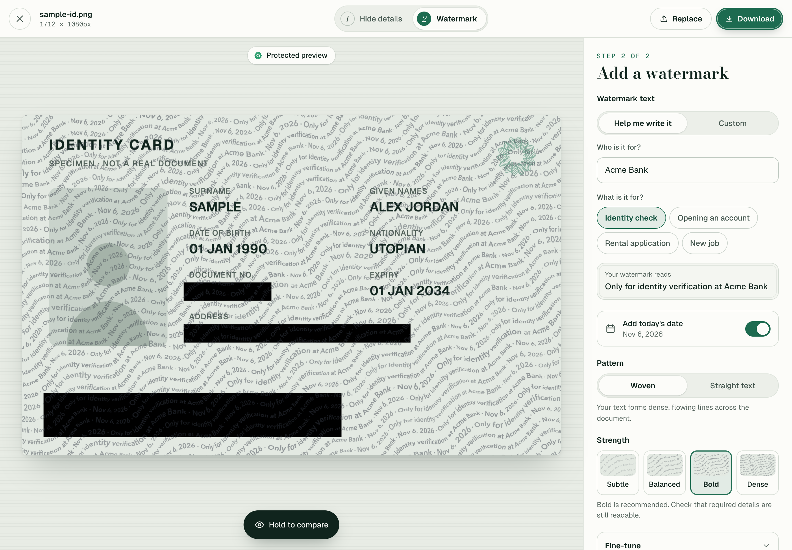

<div align="center">


# KYCWatermark.com

**Watermark your ID before you hand it over.**

Black out what a company doesn't need, stamp who the copy is for and when, and download an image that's clearly marked for that purpose only.

**[Open kycwatermark.com →](https://kycwatermark.com)**

</div>



## What it does

Banks, landlords and employers often ask for a copy of your passport or ID card. Once sent, that copy can be stored, forwarded or leaked, and reused for something you never agreed to. A visible watermark saying who the copy is for and why makes it much harder to pass off anywhere else.

- **Hide what they don't need.** Drag black boxes over your document number, address or anything else they haven't asked for. You can move, resize, rotate or remove each box.
- **Say who it's for.** Enter the company and pick the purpose, and the text is written for you, like "Only for identity verification at Acme Bank". Or write your own.
- **Add today's date.** It's on by default and works with either kind of text.
- **Choose a pattern and strength.** Woven repeats your watermark text in dense, flowing curves with curved letter strokes and gradually varying waves. It starts on Bold; choose Subtle, Balanced or Dense, or switch to Straight text. Fine-tune visibility, text density, size, wave frequency, letter variation, direction, color, spacing and position.
- **Download or copy.** Save a PNG named after the recipient, or copy the image straight to your clipboard.

No document handy? The site has a sample ID you can try it with.

Each opened document gets a random pattern seed that stays fixed while editing,
comparing and exporting. The PNG contains the final pixels, including opaque
redactions; exports always include these edits even while comparing the original.
Woven is intended to make clean removal more difficult, but it is not a guarantee
against AI editing or filtering. Check that the recipient can still read required
details. See [the rendering notes](./docs/watermark-rendering.md) for the design
rationale and remaining resilience checks.

## Privacy

- Your file is opened and edited inside your browser tab. It isn't sent anywhere.
- Once the page has loaded, you can go offline and keep working.
- The downloaded image carries no location, camera or date-taken details.
- All the code is in this repository, so anyone can check.

## Run locally

### Prerequisites

- Node.js 22.12+
- pnpm 10+

### Clone the repository

```bash
git clone https://github.com/EnriqCG/kycwatermark.com.git
cd kycwatermark.com
```

### Setup

```bash
pnpm install
```

### Start the development server

```bash
pnpm dev
```

Open `http://localhost:5173` in your browser.

### Run the tests

```bash
pnpm test
```

This runs the unit tests and the golden rendering tests. [tests/rendering/README.md](./tests/rendering/README.md) explains the golden tests and how to approve a rendering change.

When changing the default pattern, also refresh the [published preview images](./docs/preview-assets.md).

### Production build and preview

```bash
pnpm build
pnpm preview
```

## Tech stack

- React 19
- TypeScript 6
- Vite 8
- Tailwind CSS 4
- Cloudflare Pages (via Wrangler)
